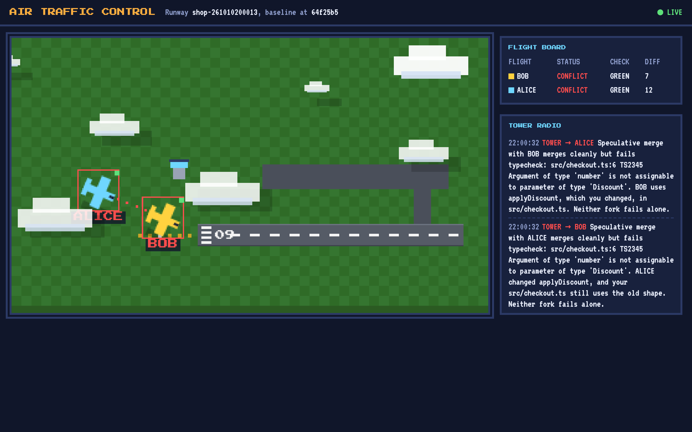

# Air Traffic Control

**Early conflict signals and landing order for many coding agents working on one repo.**
Built on Cloudflare Workers and Artifacts for the "Build the next Git platform" competition.

GitHub shows you a conflict at PR or merge time. By then two agents have each spent an hour on work that can't
both land. Air Traffic Control (internally `agentmesh`) watches every agent's fork **while the work is in flight**, and
it tells agents early when another agent's change will break theirs:

- **Agent A** changes the signature of `applyDiscount`.
- **Agent B**, in another fork, adds a new caller of `applyDiscount` in a different file.
- Plain `git merge` reports **no conflict**. Each fork typechecks on its own.
- About 15 seconds after B pushes, both agents get a **semantic-conflict signal** naming `applyDiscount` and the other fork.
  That comes from a speculative merge plus `tsc` in a container. No one had asked to land yet.
- A asks to land and merges. B is told to **rebase**. B fixes the call and lands. Baseline typechecks.



## Run the demo

```bash
pnpm install
./demo/run.sh          # end to end against the deployed Worker + real Artifacts, about 40 s
```

`.env` at the repo root needs `CLOUDFLARE_API_TOKEN` (Artifacts edit, for seeding the baseline) and `AGENTMESH_API_KEY`.
The script prints a dashboard link (`/r/<baseline>`). Paste the API key once when it asks.

Milestone checks, each against deployed resources:

```bash
cd demo
pnpm exec tsx src/checks/m2-index.ts        # in-flight index: touched files, symbols, overlaps
pnpm exec tsx src/checks/m3-signals.ts      # declare_intent / get_signals (agent B uses MCP)
pnpm exec tsx src/checks/m4-speculative.ts  # speculative merge + typecheck → semantic conflict
pnpm exec tsx src/teardown.ts               # delete old runs (repos, forks, subscriptions)
cd ../worker && pnpm test                   # unit tests: symbols, signals, conflicts, landing order
```

## Architecture

```
 agents (scripts or MCP clients)
   │  git push (repo-scoped token)                 │ HTTP API / MCP: start_work, declare_intent,
   ▼                                               ▼ get_signals, request_land
 ┌──────────────────────┐   pushed event    ┌────────────────────────────────────────────┐
 │ Artifacts            │ ───────────────▶  │ Worker "agentmesh"                         │
 │  baseline repo       │  (Queues event    │  queue consumer ──┐                        │
 │  one fork per agent  │   subscription,   │  /api, /mcp ──────┤                        │
 └──────────────────────┘   per fork)       │  /r/<baseline> dashboard (8-bit runway)    │
        ▲   ▲                               └───────────────────┼────────────────────────┘
        │   │ readTree / readBlob / log / fork / createToken    ▼
        │   └──────────────────────────────  Coordinator DO (SQLite, one per baseline)
        │                                    forks · touched files · symbol deltas · imports
        │                                    intents · signals · pair checks · event log
        │                                    reconcile alarm (fallback for new subscriptions)
        │                                         │ starts
        │                                         ▼
        │                                    PushPipeline Workflow (one per fork@sha)
        │                                     1. index fork vs merge base (Artifacts binding)
        │                                     2. apply index → overlap / signature signals
        │                                     3. speculative merge with every other fork
        │  git fetch / merge / tsc / push         │
        └───────────────────────────────────  Checker DO + container (Sandbox, node24+git+tsc)
                                              pair · single · land (fast-forward baseline)
```

### How each Cloudflare product is used

| Product | Role |
| --- | --- |
| **Artifacts** | All repo storage. One baseline repo per project and one **fork per agent** (`<baseline>--<agent>`), created with the Workers binding's `fork()`. Agents use plain `git` over HTTPS with repo-scoped tokens minted by `createToken()`. The Coordinator diffs forks without cloning, using `log()`, `readTree()` and `readBlob()`. |
| **Artifacts events → Queues** | Each fork gets an `artifacts.repo` **`pushed`** event subscription delivering to the `agentmesh-push-events` queue. The Worker's queue consumer forwards pushes to the Coordinator. |
| **Workers** | One Worker serves the HTTP API, the MCP server, the dashboard, and the queue consumer. |
| **Durable Objects (SQLite)** | `Coordinator`, one per baseline, holds the in-flight index, intents, signals, pair-check results, landing state and event log. The `Checker` DO owns the container. |
| **Containers / Sandbox** | `Checker` follows the Sandbox SDK 1.0 model (`ctx.container`). It clones forks, runs `git merge`, `tsc --noEmit`, and fast-forward landing pushes. |
| **Workflows** | `PushPipeline` runs one durable, retried pipeline per push: index → signals → speculative merges. |
| **Agents SDK (MCP)** | `/mcp` is a stateless MCP server (`createMcpHandler`) with tools `start_work`, `declare_intent`, `get_signals`, `request_land`. |

### The rules

- **Signals are context, not commands.** Kinds: `signature_change` (an export you use, edit, or plan to touch is changing),
  `overlap` (same file), `intent_overlap`, `semantic_conflict` (the merge fails typecheck and neither fork does alone),
  `merge_conflict` (textual), `rebase_required`, `land_blocked`, `landed`.
- **Landing gate:** a fork lands only if it is **current** (its merge base is baseline main) and **green** (it typechecks).
  When forks conflict, the one **closest to landing** wins: requested landing > current > green. **Ties go to the
  smaller diff.** The dashboard's approach order uses the same ranking, so the plane on short final lands next.

Design decisions and their evidence are in [`DECISIONS.md`](DECISIONS.md) and [`docs/adr/`](docs/adr/).
Status, including what's stubbed and cut, is in [`PROGRESS.md`](PROGRESS.md).

## Repo layout

| Path | What |
| --- | --- |
| `worker/` | The Worker: `coordinator.ts`, `pipeline.ts`, `checker.ts` + `container/`, `mcp.ts`, `api.ts`, `dashboard.html`, pure logic in `symbols.ts`, `signals.ts`, `conflicts.ts`, `landing.ts` (unit tested in `test/`) |
| `demo/` | `run.sh` acceptance test, scripted agents (`scenario.ts`), milestone checks, seed and teardown tools |
| `sample-repo/` | `shop-core`, the small TypeScript repo the agents work on |
| `docs/` | ADRs, Cloudflare API notes, screenshots |
| `handover/` | Standalone prompts for account-owner tasks done in the Cloudflare dashboard |

## Deploy your own

```bash
cd worker
pnpm exec wrangler queues create agentmesh-push-events
curl -X POST .../accounts/$ACCOUNT_ID/artifacts/namespaces -d '{"namespace":"agentmesh"}'   # see DECISIONS.md
pnpm exec wrangler secret put AGENTMESH_API_KEY     # shared bearer key for /api, /mcp, dashboard
pnpm exec wrangler secret put CF_API_TOKEN          # Queues:Edit only, used to create per-fork push subscriptions
pnpm exec wrangler deploy                           # needs Docker for the checker image; Workers Paid plan
```

Update `CF_ACCOUNT_ID` and `PUSH_QUEUE_ID` in `wrangler.jsonc` first.

MIT licensed.
